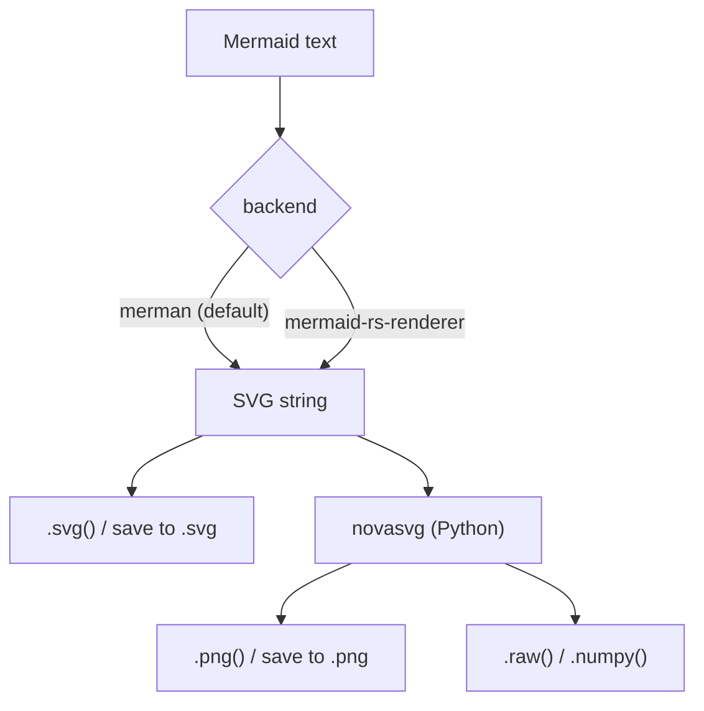

<div align="center">

# mmdr

**Render Mermaid diagrams to SVG, PNG or raw pixels from Python or the command line.**<br/>
No browser, no Node.js, no Chromium — `pip install mmdr` is all you need.

[](https://pypi.org/project/mmdr)
[](https://pypi.org/project/mmdr)
[](https://github.com/MohammadRaziei/mmdr/actions/workflows/publish.yml)
[](LICENSE)

[Documentation](https://mohammadraziei.github.io/mmdr) ·
[Quick start](#quick-start) ·
[Benchmarks](#benchmarks) ·
[Changelog](CHANGELOG.md)

</div>

---

```python
import mmdr

d = mmdr.render("flowchart LR; A-->B-->C")
d.save("diagram.svg")
d.save("diagram.png", width=1200, background="#ffffff")
```

mmdr is a Python package with the Mermaid rendering engines written in Rust and compiled into the wheel. The usual way to render Mermaid outside a browser is [mermaid-cli](https://github.com/mermaid-js/mermaid-cli) (`mmdc`), which starts headless Chrome for every diagram. mmdr skips that: there is no JavaScript runtime to boot, so it starts fast and drops easily into scripts, CI jobs and notebooks.

## Highlights

- **Nothing to install besides the wheel.** The Rust engines are inside it; the only Python dependency is [novasvg](https://mohammadraziei.github.io/novasvg/), which pip fetches for you.
- **Two backends in one package.** `merman` (default) aims for parity with the official Mermaid library; `mermaid-rs-renderer` is the faster one. Pick per call with `backend=`.
- **Much faster than mermaid-cli in the mermaidx benchmark.** Median per diagram: 22.9 ms (`merman`) and 16.2 ms (`mermaid-rs-renderer`) against 791 ms for `mmdc`. [Details and caveats below.](#benchmarks)
- **Four output formats.** SVG, PNG, raw RGBA pixels and NumPy arrays. No Pillow.
- **A CLI that feels like `mmdc`.** Files or stdin/stdout, so it works in pipelines.
- **Jupyter-ready.** A `Diagram` displays itself inline.

## Installation

```bash
pip install mmdr
```

| Command | Adds |
| --- | --- |
| `pip install mmdr` | Both backends, the CLI, SVG / PNG / raw output. |
| `pip install mmdr[numpy]` | NumPy, needed only by `Diagram.numpy()`. |

> [!NOTE]
> **Upgrading from 0.3?** Version 0.4 changed a few things: PNG and pixel output now go through novasvg (a required dependency), `mmdr.svg_to_png()` and `mmdr.svg_to_raw()` were removed, and `mermaid-rs-renderer` raises `ValueError` on invalid input instead of returning an error SVG. See the [changelog](CHANGELOG.md).

## Quick start

### Python

`mmdr.render()` returns a `Diagram`. Rendering is lazy: nothing runs until you ask for an output, and the SVG is cached after the first call.

```python
import mmdr

d = mmdr.render("""
flowchart TD
    A[Start] --> B{Is it working?}
    B -- Yes --> C[Great!]
    B -- No  --> D[Debug it]
    D --> B
""")

svg = d.svg()                                   # str
png = d.png(width=1200, background="#ffffff")   # bytes, transparent if no background
raw, w, h = d.raw()                             # RGBA8888 bytes, width, height
arr = d.numpy()                                 # (H, W, 4) uint8 array, needs numpy
d.save("diagram.svg")                           # format follows the extension
```

In a notebook, evaluating `mmdr.render("sequenceDiagram\n  Alice->>Bob: Hello!")` as the last line of a cell shows the diagram inline.

### Command line

```bash
mmdr -i diagram.mmd -o diagram.svg
mmdr -i diagram.mmd -o diagram.png --width 1200 --background '#ffffff'
echo 'flowchart LR; A-->B-->C' | mmdr -i - -o diagram.svg
echo 'flowchart LR; A-->B-->C' | mmdr -i - -o - > diagram.svg
```

Convert every `.mmd` file in a folder:

```bash
for f in diagrams/*.mmd; do mmdr -i "$f" -o "${f%.mmd}.png" --background '#ffffff'; done
```

## How it works



| Stage | Done by | Language |
| --- | --- | --- |
| Parse, lay out, draw SVG | `merman` or `mermaid-rs-renderer` | Rust |
| SVG to PNG / pixels | [novasvg](https://mohammadraziei.github.io/novasvg/) | Python package |

mmdr only renders Mermaid. To rasterize an SVG you already have, use novasvg directly:

```python
import novasvg

doc = novasvg.Document.load_from_data(open("diagram.svg").read())
png = doc.render_to_bitmap(1200, -1, novasvg.Color("white")).to_png()
```

## Backends

| | `merman` (default) | `mermaid-rs-renderer` |
| --- | --- | --- |
| Aim | Parity with the official Mermaid library | Fast rendering of common diagrams |
| Benchmark: diagrams drawn | 50 of 50 | 45 of 50 |
| Benchmark: median per diagram | 22.9 ms | 16.2 ms |
| Extra options | none | `theme`, `node_spacing`, `rank_spacing`, `aspect_ratio` |

```python
mmdr.backends()   # ['merman', 'mermaid-rs-renderer']

d = mmdr.render(
    "flowchart LR; A-->B-->C",
    backend="mermaid-rs-renderer",
    theme="classic",          # "modern" (default) or "classic"
    node_spacing=60.0,
    rank_spacing=80.0,
    aspect_ratio=(16, 9),
)
```

Invalid diagrams raise `ValueError` when the SVG is first needed.

**Diagram types.** Both backends rendered every type in this list in our checks: flowchart, sequence, class, state, ER, pie, gantt, timeline, mindmap, journey, gitGraph, xychart, quadrant, sankey, block, architecture, kanban, C4 and packet. Drawing a type is not the same as drawing every feature of it: in the benchmark `mermaid-rs-renderer` rejected five samples, namely the bare `info` diagram, three sequence diagrams that use `+`/`-` activation shorthand or participants it could not resolve, and a class diagram with a `<<abstract>>` annotation. `merman` drew all 50. The `merman` backend reports which Mermaid version it follows: run `mmdr --info`.

## Benchmarks

The [mermaidx benchmark](https://mohammadraziei.github.io/mermaidx/benchmarks) renders the same 50 Mermaid diagrams with mermaid-cli and with each mermaidx backend. mermaidx uses mmdr as its engine for the rows below (`rust:merman` and `rust:mermaid-rs-renderer`).

| Renderer | Median per diagram | Compared with mermaid-cli | Produced an image | First render in a process |
| --- | --- | --- | --- | --- |
| mermaid-cli (`mmdc`) | 791 ms | reference | 50 of 50 | 1.94 s |
| mmdr `merman` | 22.9 ms | 35× faster | 50 of 50 | 7.1 ms |
| mmdr `mermaid-rs-renderer` | 16.2 ms | 41× faster | 45 of 50 | 13.8 ms |

How to read it:

- The clock covers Mermaid text to PNG bytes. `mmdc` is started once per diagram, so its time includes starting Node.js and Chrome; that is the cost of using it in a script, not its layout speed.
- Medians are taken over the diagrams each renderer handled. The speed-up is the median of per-diagram ratios.
- Producing an image does not mean producing a correct one. Compare the pictures in the [gallery](https://mohammadraziei.github.io/mermaidx/benchmarks) before choosing a backend.
- Absolute times depend on the CI machine that ran the job. See [how the benchmarks work](https://mohammadraziei.github.io/mermaidx/docs/benchmarks-method).

## API and CLI essentials

| Python | Returns | Notes |
| --- | --- | --- |
| `mmdr.render(source, backend=None, **opts)` | `Diagram` | Lazy. `backend` is `"merman"` (default) or `"mermaid-rs-renderer"`. |
| `Diagram.svg()` | `str` | Cached after the first call. |
| `Diagram.png(width, height, background)` | `bytes` | Transparent unless `background` is given. If only one size is given, the other follows the aspect ratio. |
| `Diagram.raw(width, height, background)` | `(bytes, w, h)` | Straight (non-premultiplied) RGBA8888. |
| `Diagram.numpy(width, height, background)` | `ndarray` | `(H, W, 4)`, `uint8`. Needs `mmdr[numpy]`. |
| `Diagram.save(path, ...)` | `None` | `.svg` or `.png`; `.pdf` is not supported yet. |
| `mmdr.backends()` | `list[str]` | Backends compiled into this wheel. |

| CLI flag | Meaning |
| --- | --- |
| `-i`, `--input` | Input file; `-` (default) reads stdin. |
| `-o`, `--output` | Output file; `-` writes to stdout. The format follows the extension. |
| `-e`, `--format` | Force `svg` or `png`. |
| `--backend` | `merman` (default) or `mermaid-rs-renderer`. |
| `-w`, `--width` / `-H`, `--height` | PNG size in pixels. |
| `-b`, `--background` | PNG background, e.g. `'#ffffff'` or `white`. |
| `-t`, `--theme`, `--node-spacing`, `--rank-spacing`, `--aspect-ratio W:H` | `mermaid-rs-renderer` only. |
| `--info`, `--version`, `-h` | Show Mermaid's built-in info diagram, the mmdr version, or all options. |

Full reference: [documentation](https://mohammadraziei.github.io/mmdr).

## Requirements

- Python 3.9 or newer, on Windows, macOS or Linux (pre-built wheels).
- To build from source: [Rust](https://rustup.rs) (the `merman` crate needs Rust 1.95 or newer) and [maturin](https://github.com/PyO3/maturin).

## Testing

```bash
pip install maturin pytest numpy
maturin develop --release
pytest tests/
```

## Contributing

Issues and pull requests are welcome at [github.com/MohammadRaziei/mmdr](https://github.com/MohammadRaziei/mmdr).

## License

MIT. See [LICENSE](LICENSE).

## Acknowledgements

mmdr wraps two Rust Mermaid renderers, [`mermaid-rs-renderer`](https://github.com/1jehuang/mermaid-rs-renderer) by 1jehuang and [`merman`](https://crates.io/crates/merman), and rasterizes with [novasvg](https://mohammadraziei.github.io/novasvg/).
